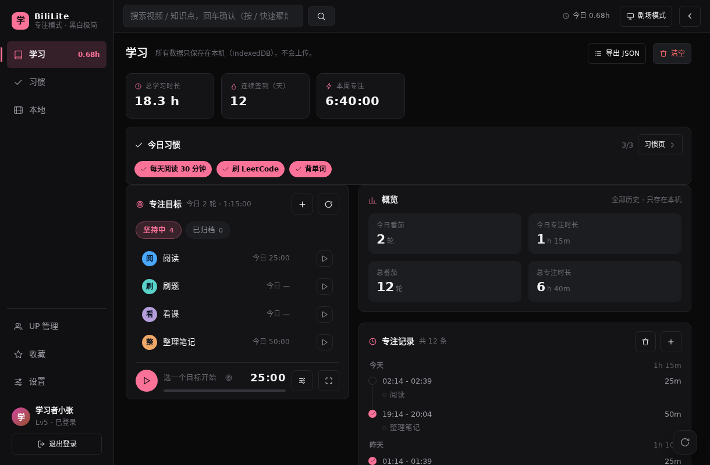
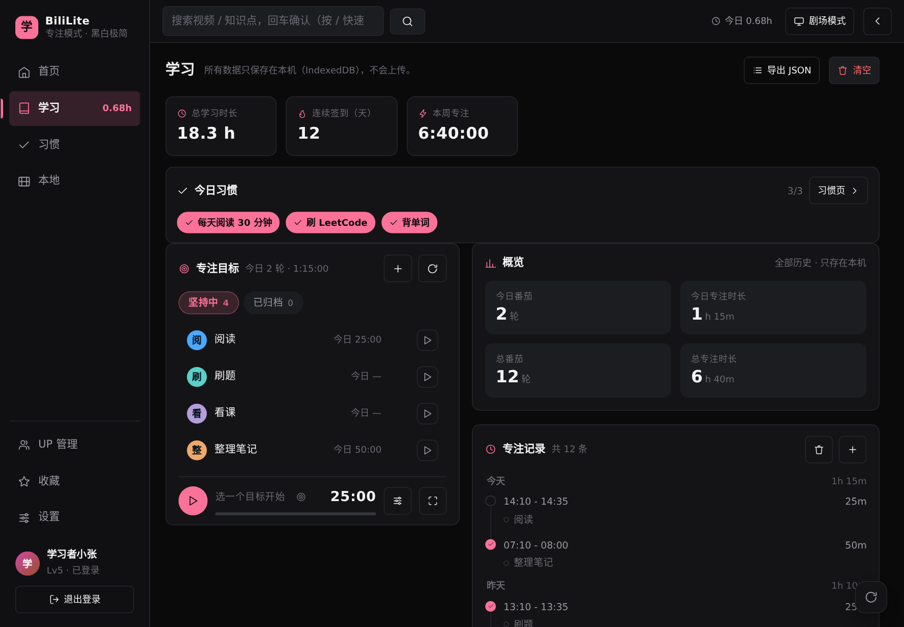

# BiliLite 0.4.4 — Android APK 前端源码还原工程（本机构建 0.4.9）

**下载 APK**：`BiliLite-0.4.9-debug.apk`（本仓库根，4,105,445 B，sha256 `37e15de561925ca4ab53c643d456f9a2017e4a4c27af21ed0dd07db93fec0c3f`）—— 由本工程源码构建，versionCode 13 / versionName 0.4.9，含本机定制改动「笔记按分P独立 + 回车换行」（[docs/12](docs/12-笔记按分P独立.md)）、「备份导入恢复 + 修正『打开』变『保存』」（[docs/13](docs/13-备份打开与导入恢复.md)）、「笔记行按钮调整 + 小窗播放改成右下角小圆圈」（[docs/14](docs/14-小窗圆形气泡与笔记行按钮.md)）、「离开播放页时视频自动缩成暂停小圆、点回继续播」（[docs/15](docs/15-离开播放页自动暂停小窗.md)）与「删除首页（打开即学习页）」（[docs/16](docs/16-删除首页.md)）。**0.4.9 还没发 Release**，需要时打 `v0.4.9-restore` tag 即可。上一版 `BiliLite-0.4.8-debug.apk`（4,108,755 B，sha256 `bb61006c654f1d49eb04bee9fe9cdc8a3fd35ffc51310d9c45c94de041e20ca1`，[Release v0.4.8-restore](https://github.com/1suien/BiliLite/releases/tag/v0.4.8-restore)）、`BiliLite-0.4.7-debug.apk`（4,108,456 B，sha256 `bee3d8169cc0d0db914c12b51799dfbb76a4138ac588a78501e43017e5d9f8bc`）、`BiliLite-0.4.6-debug.apk`（4,109,055 B，sha256 `b34d26d539fa93c62032c661ac5147c681dbe846d27472e381fa74f5c7da16c8`）、`BiliLite-0.4.5-debug.apk`（4,107,722 B，sha256 `9f0bda8d9e9a74810dd55815fb74b4f2169a539c2b67da18ba15a6890186e6c4`）、`BiliLite-0.4.4-debug.apk`（4,107,559 B，sha256 `d7ceccfe86aa17e582b7b380c26f337acb62e1dd0e09bf4ad031004e5fcc81c0`）与 0.4.3 的历史产物 `BiliLite-0.4.3-debug.apk`（4,107,542 B，sha256 `b4fd3333abe25a1e2881ca142ee187ad7bca0d015398c4cd81babb0e7350abe3`，[Release v0.4.3-restore](https://github.com/1suien/BiliLite/releases/tag/v0.4.3-restore)）保留在仓库根作对照。

把 `BiliLite-0.4.3-android-debug.apk`（4.1 MB）里的**前端部分完整解包、还原成可读、可构建、可继续开发的 Vue 3 + TypeScript 工程**，并把「原始产物」与「还原结果」并排放好，方便逐项对照。

> **已跟进到 0.4.4（2026-10-25）**：官方 0.4.4 只改了一处真实行为——安卓剧场模式的「退出剧场」按钮被 `top`+`bottom` 同时约束、拉成贯穿屏幕的竖白条（本次修复）；再加 3 处版本号。本工程已把这份增量同步进 `app/` 并重新出包，本地构建的 `classes*.dex` / `AndroidManifest.xml` / `resources.arsc` 与官方 0.4.4 APK **逐字节相同**。增量清单、产物比对与校验见 [docs/11](docs/11-0.4.4同步记录.md)。

> 原始 APK 是一个 **Capacitor + Vite + Vue 3** 应用：`assets/public` 里是打包后的 JS/CSS，原生壳（`classes.dex`）只负责 Capacitor 桥和两个自定义插件（画中画、沉浸式）。APK 里**没有 sourcemap**，所以这不是「解出原始 TS 源码」，而是**依据压缩产物逐函数重写出来的等价源码**。
>
> **后续补充**：作者在 `v0.4.3` tag 上公开了完整原始源码（commit `dd3e5cff`）。本工程已把它快照进 `reference/upstream-v0.4.3/`，把完整的安卓 Gradle 工程 + 3 个 Java 插件源码补进 `app/android/`，并用上游源码对还原工程做了逐模块核对（[docs/08](docs/08-与上游源码逐模块核对.md)，5 份分模块报告共 1692 行）。核对发现并修复了 7 处真实偏差，其余差异全部登记。`v0.4.4` 的增量（6 个文件）另存为 `reference/upstream-v0.4.4/`（改动文件 + 完整 `CHANGES.diff` + `PROVENANCE.md`），与 v0.4.3 快照叠加即完整源码树。
>
> **播放方式对比**：用户提供的 BiliLite **0.6.25 原生版**（Compose + Media3/ExoPlayer）已逆向拆解，与本工程 0.4.3 的 WebView/MSE 播放链路逐项对比（取流/选轨/装配/缓冲/字幕/后台/缓存），见 [docs/10](docs/10-播放方式对比.md)。

> **本机定制改动（2026-10-25，0.4.5）**：修了两件用户反馈的事——① 视频笔记**按分P独立**（`db.notes` 读取从「只按 `bvid`」改成 `bvid + cid`，同一个 199 分P的课程不再共用一份笔记）；② 笔记输入框从单行 `<input>` 改成多行 `<textarea>`，**回车换行**、`Ctrl+Enter` 或「保存」按钮写入。这是本仓库自己的改动，上游 0.4.4 没有；改动清单、端到端验证与升级说明见 [docs/12](docs/12-笔记按分P独立.md)。
>
> **本机定制改动（2026-10-25，0.4.6）**：① 设置页「备份目录 → 打开」在安卓上实际弹的是系统「保存到…」面板（按钮名与行为对不上），安卓上已隐藏这行、改为「备份位置」说明；② 新增「恢复学习数据 → 打开 JSON 备份…」，选一份导出的 `.json` 与现有数据**合并**恢复（进度按 `updatedAt` 取新、每日时长取大、清单按 `bvid` 取新、笔记按 `bvid+cid+at+text` 去重）。详见 [docs/13](docs/13-备份打开与导入恢复.md)。
>
> **本机定制改动（2026-10-26，0.4.7）**：① 笔记行去掉「▶ 跳转」按钮（用户要「完全不要跳转」），每条的删除按钮挪到整行最右边；② 播放页「小窗播放」文字按钮改成**圆形图标入口**，播放中的视频从长方形小窗改成右下角 **112×112 圆形气泡**——圆里是实时画面 + 进度环 + 时间，点气泡回到播放页并从当前进度继续，可拖动、跨页面常驻，右上角 × 关闭。这是本仓库自己的界面定制，上游没有；细节见 [docs/14](docs/14-小窗圆形气泡与笔记行按钮.md)。

> **本机定制改动（2026-10-26，0.4.8）**：播放视频时点左侧导航（或任何离开播放页的入口），视频不再直接消失，而是**自动缩成右下角 112×112 圆形小窗并暂停**，停在离开的那一帧；点小圆回到播放页后**自动从暂停处继续播**。同页换分P/换视频、刷新/关窗口、拉流失败都不触发；手动「小窗播放」入口行为不变。这是本仓库自己的交互定制，上游没有；实现细节与 18/18 端到端验收见 [docs/15](docs/15-离开播放页自动暂停小窗.md)。

> **本机定制改动（2026-10-26，0.4.9）**：**删除「首页」**——左侧导航的「首页」条目、`/` 路由与 `views/HomeView.vue`（219 行）全部删除，打开 App 直接进「学习」页；`#/` 与旧地址 `#/home` 都自动落到 `#/learn`。连带把「回首页」「去首页找视频」等文案改成「回学习」「去搜索找视频」，UP 管理相关文案去掉「首页会显示…」的说法。首页原来的「继续学习 / 关注 UP 更新」入口随之消失（UP 名单仍保留、仍能管理，只是不再有页面消费它）。这是本仓库自己的删减，上游没有；细节与 10/10 验收见 [docs/16](docs/16-删除首页.md)。

> **浏览器直接下载**：本机 DSH Web 装了一个只读下载路由（`tools/dsh-download-route/`，`@local/download-route`），打开 `http://127.0.0.1:3080/dl/BiliLite-0.4.9-debug.apk` 即下载（`Content-Disposition: attachment`，MIME `application/vnd.android.package-archive`）。路由只允许工作目录内的相对路径，`..` 穿越返回 403；详见 [docs/09](docs/09-生成可安装APK.md) 的「安装」一节。
>
> **想覆盖本地那份旧 APK**：用固定文件名入口 `http://127.0.0.1:3080/dl/BiliLite-latest.apk`——它指向仓库根软链 `BiliLite-latest.apk` → 最新产物，重复下载得到同名文件，浏览器/文件管理器里选「替换」就覆盖了本地那份；出完新包跑 `tools/build/link-latest-apk.sh` 刷新软链。

> **已经能出安装包**：`app/` 源码 → `npm run build` → `cap sync` → `gradlew assembleDebug` 在本机实测通过，当前产物 `BiliLite-0.4.9-debug.apk`（4,105,445 B，签名/对齐校验通过；0.4.8 的 4,108,755 B、0.4.7 的 4,108,456 B、0.4.6 的 4,109,055 B、0.4.5 的 4,107,722 B、0.4.4 的 4,107,559 B 与 0.4.3 的 4,107,542 B 也保留在仓库里），见 [docs/09](docs/09-生成可安装APK.md)。

---

## 目录结构

```
/root/学习软件
├── README.md                     ← 本文件
├── BiliLite-0.4.9-debug.apk      ← ★ 由本工程源码构建出的可安装 APK（4.11 MB，本机 0.4.9 定制版：删除首页，见 docs/16）
├── BiliLite-0.4.8-debug.apk      ← 本机 0.4.8 产物（离开播放页自动缩成暂停小圆，见 docs/15）
├── BiliLite-0.4.7-debug.apk      ← 本机 0.4.7 产物（笔记行按钮 + 小窗圆形气泡，见 docs/14）
├── BiliLite-0.4.6-debug.apk      ← 本机 0.4.6 产物（备份导入恢复，见 docs/13）
├── BiliLite-0.4.5-debug.apk      ← 本机 0.4.5 产物（笔记按分P独立，见 docs/12）
├── BiliLite-0.4.4-debug.apk      ← 官方 0.4.4 同源产物（保留作对照）
├── BiliLite-0.4.3-debug.apk      ← 上一版产物（0.4.3 源码构建，保留作对照）
├── CONTRACT.md                   ← 还原时的内部契约（公共 API 速查 / 模板反推规则）
├── app/                          ← ★ 还原出的前端工程（可 npm run build / dev）
│   ├── package.json  vite.config.ts  tsconfig.json  index.html  capacitor.config.json
│   └── src/
│       ├── main.ts               ← 启动入口（装桥 → 装原生能力 → mount → 接管返回键）
│       ├── App.vue               ← 外壳：侧栏导航 + 顶栏搜索 + 剧场模式 + 快捷键
│       ├── router/               ← 13 条 hash 路由
│       ├── views/                ← 12 个页面（Home/Search/Video/Fav/FavFolder/Learn/Habit/Local/LocalPlayer/UpManage/Up/Settings）
│       ├── components/           ← 18 个组件（VideoCard/PartList/FocusPanel/BiliImage/Icon/…）
│       ├── stores/               ← 9 个 pinia store（auth/settings/learn/habits/ups/collect/mini/ui/pomodoro）
│       ├── db/                   ← Dexie 本地库 study-bili（v1→v7 schema 完整保留）
│       ├── bridge/               ← 数据桥：window.bili 的类型、安卓实现（37 个通道）、WBI 签名、持久化
│       ├── player/               ← 自研 DASH/MSE 播放内核（1446 行）+ 清晰度表
│       ├── native/               ← Capacitor 插件封装（剪贴板 / 全屏 / 画中画 / 沉浸式 / 返回键）
│       ├── utils/format.ts       ← 数字/时间格式化
│       ├── dev/seed.ts           ← 【新增】演示数据（仅 mock 模式用）
│       └── styles/               ← 全局样式 + 按组件拆回的 scoped CSS
├── app/android/                  ← ★ 完整可构建的 Android 工程（Gradle 8.2.1 / AGP 8.2.1 / minSdk 22）
│   └── app/src/main/java/…       ← MainActivity / PipPlugin / ImmersivePlugin 真源码
├── android/                      ← 从 APK 解码出的安卓侧资料（Manifest / 资源 XML / 图标）
├── reference/
│   ├── apk-dist/                 ← APK 内 assets/public 原样拷贝（原始 JS/CSS/HTML）
│   ├── decompiled/               ← 用 prettier 美化后的 41 个 JS chunk + 12 个 CSS
│   ├── upstream-v0.4.3/          ← 官方源码快照（tag v0.4.3，89 文件 / 1.1 MB，见 PROVENANCE.md）
│   ├── upstream-v0.4.4/          ← 官方源码增量快照（tag v0.4.4：6 个改动文件 + CHANGES.diff）
│   └── screenshots/              ← 用无头 Chromium 跑出来的页面截图（mock 数据）
├── tools/                        ← 还原工具链（CSS 拆分、组件映射、AXML/ARCS 解码、浏览器验收）
│   ├── audit/                    ← 上游源码机械比对脚本（通道/设置/Dexie/WBI，可复跑）
│   └── build/                    ← 出包脚本（build-apk.sh / aarch64 的 aapt2-qemu.sh / 免 Gradle 重打包）
├── docs/                         ← 详细文档
│   ├── 01-架构总览.md            02-路由与页面.md           03-还原方法与还原度.md
│   ├── 04-数据层与本地存储.md     05-数据桥API清单.md        06-原生能力与安卓工程.md
│   ├── 07-构建验收与开发者工具.md 08-与上游源码逐模块核对.md
│   ├── 09-生成可安装APK.md         ← 本机实测出包记录（环境搭建 / 校验 / 安装说明）
│   ├── 10-播放方式对比.md          ← 0.4.3（WebView/MSE）vs 0.6.25（原生 ExoPlayer）播放实现对比
│   ├── 11-0.4.4同步记录.md        ← 0.4.3→0.4.4 增量、APK 产物比对、二次出包校验
│   ├── 12-笔记按分P独立.md        ← 本机定制改动：笔记按 bvid+cid 独立、回车换行、0.4.5 出包
│   ├── 13-备份打开与导入恢复.md    ← 本机定制改动：安卓备份行修正、打开 JSON 备份导入/合并、0.4.6 出包
│   ├── 14-小窗圆形气泡与笔记行按钮.md ← 本机定制改动：笔记行去掉跳转、小窗改圆形气泡、0.4.7 出包
│   ├── 15-离开播放页自动暂停小窗.md ← 本机定制改动：离开播放页自动缩成暂停小圆、点回继续播、0.4.8 出包
│   ├── 16-删除首页.md            ← 本机定制删减：删除首页、启动即学习页、0.4.9 出包
│   └── audit/                    ← 5 份分模块核对报告（样式/数据/视图/store/播放内核）
└── .work/                        ← APK 原始解包目录（ground truth，勿改）
```

---

## 快速开始

```bash
cd app
npm install            # 78 MB，含 vue/vue-router/pinia/dexie/qrcode/mpegts.js/@capacitor/*
npm run dev            # 开发服务器；用普通浏览器打开 → 自动进入 mock 演示模式
npm run build          # 产物输出 app/dist（与 APK 内 assets/public 结构对应）
npm run preview        # 预览构建产物（需带 ?mock=1 才有假数据，见下）
npm run typecheck      # vue-tsc，当前 0 错误
npm run sync           # cap sync android：把 dist 同步进 app/android 的 web 资源
npm run apk            # cap build android --androidreleasetype APK（需要 JDK 17 + Android SDK）
```

**演示模式（新增的开发者工具，原 APK 没有）**

APK 的渲染层只依赖原生注入的 `window.bili`，在浏览器里直接打开会提示「未检测到桌面端桥接」。为了能在电脑上预览/验收，本工程加了：

- `?mock=1`：强制启用 **mock 数据桥**（`src/bridge/mock.ts`，纯本地假数据，不联网）；
- 开发模式（`npm run dev`）下如果没有任何桥被注入，也会自动进入 mock 模式；
- `?mock=1` 只在本机来源（`localhost`/`127.0.0.1`/`[::1]`）或 dev 下生效，其它来源会被忽略并打印 warn（避免真机上被诱导打开后往真实 IndexedDB 种演示数据）；
- mock 模式会先往 IndexedDB 种一批**演示数据**（`src/dev/seed.ts`：学习进度、每日时长、习惯、专注记录、本地视频、UP 名单……），否则学习/习惯/本地这些页面会是空的。

```bash
# 浏览器打开
http://localhost:5173/            # dev：自动 mock
http://localhost:4173/?mock=1     # preview/build 产物：必须手动加 ?mock=1
```

**想在真机上跑**：安装包已经构建好，直接在仓库根取：

```bash
adb install -r BiliLite-0.4.9-debug.apk
```

它是用 `app/android/` 这个完整 Gradle 工程在本机 `assembleDebug` 出来的（package `com.bililite.app`、versionCode 13、versionName 0.4.9、debug 签名）。0.4.4 = 0.4.3 + 剧场模式「退出剧场」CSS 修复（[docs/11](docs/11-0.4.4同步记录.md)）；0.4.5 = 0.4.4 + 本机定制「笔记按分P独立 + 回车换行」（[docs/12](docs/12-笔记按分P独立.md)）；0.4.6 = 0.4.5 + 备份交互修正与「打开 JSON 备份」导入恢复（[docs/13](docs/13-备份打开与导入恢复.md)）；0.4.7 = 0.4.6 + 笔记行按钮调整与小窗圆形气泡（[docs/14](docs/14-小窗圆形气泡与笔记行按钮.md)）；0.4.8 = 0.4.7 + 离开播放页自动缩成暂停小圆（点回继续播，[docs/15](docs/15-离开播放页自动暂停小窗.md)）；0.4.9 = 0.4.8 + 删除首页（打开即学习页，[docs/16](docs/16-删除首页.md)）。重新出包：

```bash
cd app
npm run build && npm run sync     # 产物同步进 android/app/src/main/assets/public
cd android && ./gradlew assembleDebug
```

前置条件：JDK 17 + Android SDK（compileSdk/targetSdk 34、minSdk 22），`android/local.properties` 写 `sdk.dir`；完整步骤（含 aarch64 上 aapt2 只有 x86_64 的绕法）见 [docs/09-生成可安装APK.md](docs/09-生成可安装APK.md)。与官方 APK 包名相同但签名不同，手机上已装官方版的需先卸载。

---

## 验收结果（本机已跑通）

- `npm run build`：成功，Vite 产物 ≈ 690 KB（gzip ≈ 220 KB，含 mpegts.js 懒加载 chunk）。
- `npm run typecheck`（vue-tsc）：0 错误。
- 无头 Chromium 打开 mock 模式，**11 个路由全部正常渲染**（本机 0.4.9 删掉首页后），截图见 `reference/screenshots/`（1180×820 平板横屏布局），控制台报错只有两类**预期内**的：
  1. 播放页：mock 的 `mock://` 假媒体地址被原 CSP 拦截（`connect-src`），播放器进入「这条线路暂时拿不到数据」错误态——页面其余部分（信息、分 P、清晰度、收藏、相关推荐）都正常；
  2. 本地播放：`mock://` 媒体地址被 `media-src` 拦截，属于同一原因。

  两者都不影响布局/交互还原度的验证，详见 [docs/07-构建验收与开发者工具.md](docs/07-构建验收与开发者工具.md)。

| 学习（0.4.9 起启动页） | 学习页 |
|---|---|
|  |  |

---

## 还原度总表

「还原度」是相对**原始压缩 chunk 的行为/结构**的估计：文案、class、交互、数据流逐条对照；格式与变量名当然不可能一致（原名被压缩掉了）。

| 模块 | 文件 | 对应原始 chunk | 还原度 |
|---|---|---|---|
| 外壳 | `App.vue` | `main-CoY7YGNA.js` | ~97% |
| 外壳组件 | `Toasts/PageFloat/ConfirmModal` | 同上 | 1:1 |
| 登录/小窗 | `LoginModal.vue` / `MiniPlayer.vue` | 同上 | ~96% / ~93% |
| 信息流 | `SearchView/UpView/FavView/FavFolderView`、`VideoCard/SkeletonGrid`（`HomeView` 已于本机构建 0.4.9 删除） | 各自 chunk | 97–100% |
| 播放 | `VideoView.vue`、`PartList`、`CollectModal`、`player/dash.ts`、`player/quality.ts` | `VideoView-B4FS9Q24.js`、`dash-C8KLxT-Q.js` | ~95%（弹幕层原版就没有，见下） |
| 学习 | `LearnView` + `FocusPanel/FocusTargets/FocusRecords/FocusOverview/HabitHome` + `stores/pomodoro.ts` | `LearnView-ByneIRdr.js` | 95–100% |
| 习惯 | `HabitView.vue` | `HabitView-Dj73W_T2.js` | ~97% |
| 本地 | `LocalView/LocalPlayerView` | 各自 chunk | ~96% / ~99% |
| UP 管理 | `UpManageView.vue` | `UpManageView-DfXP44oj.js` | ~96% |
| 设置 | `SettingsView.vue` | `SettingsView-oeXwRCVu.js` | ~97% |
| 数据桥 | `bridge/android.ts` + `api.ts` + `http.ts` + `wbi.ts` + `state.ts` | `index-jTHZJced.js` | 37/37 通道对应；接口字段逐一映射 |
| 本地库 | `db/index.ts` | 内联在桥 chunk 里的 Dexie 定义 | ~100%（库名/表名/schema 版本原样） |
| 样式 | `styles/global.css` + `styles/recovered/*.css` | 产物 CSS | 逐字节（只拆了作用域属性） |

逐文件说明与偏差清单见 [docs/03-还原方法与还原度.md](docs/03-还原方法与还原度.md)。

---

## 与官方源码的逐模块核对（2026-10-25）

上游在 `v0.4.3` tag 公开源码后，本工程用它当基准把还原结果**逐模块核对了一遍**。5 个模块域、约 40 项机械比对（脚本在 `tools/audit/`，报告在 `docs/audit/`）：

| 模块域 | 机械证据 | 等价度 | 已修真实缺陷 |
|---|---|---|---|
| 路由 + 外壳 + 通用组件 | 9 个 store 逐名一致、13 条路由逐条一致、无中文文案缺失 | ≈96% | 启动流程双初始化、`auth.ready`（`app/src/main.ts`） |
| 视图层 | 两侧各 408 条中文串零丢失、SFC 样式规则 225=225 | ≈98% | 收藏时间格式、`.sign clamp-1` |
| 数据层 | bridge 通道 **37/37**、`DEFAULT_SETTINGS` 18/18、Dexie v1–v7 逐条相同、WBI 211+200+6 组全等价 | ≈98% | — |
| 播放内核 | 40+ 常量、选轨、parseSidx、起流、拉流、背压、重连逐行等价 | ≈94% | `wasPlaying` 丢失导致暂停中拖进度条自动续播、分 P 首屏不定位 |
| 样式 + 适配 + 安卓壳 | CSS 变量 62 个缺失 0、`diff -r` 与上游零差异 | ≈99% | — |

另：`docs/06` 里三处与真源码矛盾的「推断」（沉浸式参数名、画中画按钮行为、`enterPip` 是否插件方法）已修正。

⚠️ 修复里最要紧的一条：**习惯提醒巡检的时间参数被写成了日期串**（`app/src/stores/habits.ts:325/338/370`），会让所有开了提醒的习惯在启动时被误判「已到点」并推送通知、当天真实时刻不再提醒 —— 已改为 `HH:mm` 并核对 APK 产物（`habits-C8Z8S-qa.js:305`）。

逐条差异、保留理由、未验证边界见 [docs/08-与上游源码逐模块核对.md](docs/08-与上游源码逐模块核对.md)。

---

## 与原 APK 的已知差异（诚实清单）

1. ~~不含完整安卓工程~~ → **已补全并实测出包**：`app/android/` 是官方 tag v0.4.3 的 `mobile/android/` 原样复制（55 个文件，3 个 Java 插件为真源码），仅 `capacitor.settings.gradle` 由 `cap sync` 按 npm 布局重新生成；本机已跑通 `gradlew assembleDebug`，0.4.4 产物 `BiliLite-0.4.4-debug.apk`（4,107,559 B，apksigner/zipalign 校验通过；原生侧与官方 0.4.4 APK **逐字节相同**，见 [docs/09](docs/09-生成可安装APK.md) 与 [docs/11](docs/11-0.4.4同步记录.md)）；当前 0.4.9 产物 `BiliLite-0.4.9-debug.apk`（4,105,445 B）额外含本机定制的笔记、备份导入、小窗圆形气泡、「离开自动暂停小圆」与「删除首页」改动（[docs/12](docs/12-笔记按分P独立.md)、[docs/13](docs/13-备份打开与导入恢复.md)、[docs/14](docs/14-小窗圆形气泡与笔记行按钮.md)、[docs/15](docs/15-离开播放页自动暂停小窗.md)、[docs/16](docs/16-删除首页.md)）。
2. **原始源码没有 sourcemap**：本工程是「行为等价重写」，不是原始 TS 源码；变量名、注释、文件切分与原作者不同。
3. **弹幕层没实现**：0.4.3 的播放页 chunk 里 `danmaku/弹幕` 出现 0 次（`dm-layer/dm-item/dm-bar` 只有 `global.css` 残留样式），数据桥虽然有 `video:danmaku/sendDanmaku` 通道但没有任何视图调用——忠实还原 = 没有弹幕 UI，故未凭空实现。
4. **首页没有推荐流**：`home:feed` / `home:popular` 只有桌面端桥（`index-B576k3Hi.js`）暴露，所有视图都没有调用；原版首页实际是「继续学习 + 关注的 UP 更新」。本机构建 0.4.9 起**首页整个删除**（[docs/16](docs/16-删除首页.md)）。
5. **浏览器 mock 模式下播放器报错**：mock 没有真实媒体流，`mock://` 又被原 CSP 拦，属于预期；真机上换真接口即可。
6. **接口需要外网 + 登录**：真实模式下所有数据来自 `api.bilibili.com`/`passport.bilibili.com`，且部分接口需要 WBI 签名与登录 cookie（桥里已实现）。
7. 若要让整体行为在浏览器里完全等同原生，还需要 Electron 桌面桥（本仓库不含，原 APK 也没有）；`bridge/index.ts` 已支持「已有 `window.bili` 直接复用」。

---

## 仓库说明（GitHub 版）

本仓库为了控制体积与版权风险，**没有**包含以下「还原依据」目录（它们只在本地工作副本里有，见 `.gitignore`）：

- `.work/`：原始 APK 及解包/反编译中间产物（官方 debug APK 的原始字节）；
- `reference/apk-dist/`：APK 内 `assets/public` 的原样拷贝；
- `reference/decompiled/`：美化后的 41 个 JS chunk + 12 个 CSS；
- `app/node_modules/`、`tools/browser/chromium-libs/` 等依赖与浏览器缓存。

仓库里保留的是：还原后的 `app/` 源码与安卓工程、`reference/upstream-v0.4.3/` 与 `reference/upstream-v0.4.4/`（MIT 上游源码快照，各带 `PROVENANCE.md`）、文档、审计脚本、构建脚本，以及构建好的 `BiliLite-0.4.9-debug.apk`、`BiliLite-0.4.8-debug.apk`、`BiliLite-0.4.7-debug.apk`、`BiliLite-0.4.6-debug.apk`、`BiliLite-0.4.5-debug.apk`、`BiliLite-0.4.4-debug.apk`、`BiliLite-0.4.3-debug.apk`。若你要复跑审计脚本对比反编译产物，请把原始 APK 放回 `.work/` 并按 [docs/03](docs/03-还原方法与还原度.md) 重新解包。

## 发布（GitHub Release）

已发布：
- [Releases · v0.4.8-restore](https://github.com/1suien/BiliLite/releases/tag/v0.4.8-restore)（最新已发布版本，对应 `BiliLite-0.4.8-debug.apk`，4,108,755 B，sha256 `bb61006c654f1d49eb04bee9fe9cdc8a3fd35ffc51310d9c45c94de041e20ca1`）
- [Releases · v0.4.7-restore](https://github.com/1suien/BiliLite/releases/tag/v0.4.7-restore)（历史版本，对应 `BiliLite-0.4.7-debug.apk`，4,108,456 B，sha256 `bee3d816…`）
- [Releases · v0.4.3-restore](https://github.com/1suien/BiliLite/releases/tag/v0.4.3-restore)（历史版本，对应 `BiliLite-0.4.3-debug.apk`）

0.4.9 的产物 `BiliLite-0.4.9-debug.apk` 目前只在仓库根（**还没发 Release**）；0.4.4–0.4.6 的产物同样只在仓库根。需要发布时按同一套流程打 `v0.4.x-restore` tag 即可（workflow 已支持 0.4.3 / 0.4.4 / 0.4.7 / 0.4.8 的前缀，0.4.9 需先按 docs/09 的说明补一个 `v0.4.9-restore*` 分支）。

Release 不是手工点的：本地只有该仓库的账号级 SSH key（可 push），没有带 `repo` 写权限的 API token，所以用 `.github/workflows/release-restore.yml` 让 GitHub 自己的 `GITHUB_TOKEN`（`permissions: contents: write`）在 CI 里 `gh release create` 建 Release 并上传 APK。复现方式：

```bash
git tag v0.4.8-restore-ci1 "$(git rev-parse HEAD~N)"   # 指向含 APK 与 docs/RELEASE-v0.4.8-restore.md 的 commit
git push origin v0.4.8-restore-ci1                      # 触发 workflow；也可在 Actions 页面 workflow_dispatch
```

workflow 幂等：`gh release view v0.4.7-restore` 已存在时覆盖资产与说明；tag 名带 `v0.4.3-restore` / `v0.4.4-restore` 前缀则走对应版本的资产与说明（历史入口保留）。

## 免责声明

本仓库是**个人学习用的逆向/还原产物**，不含 B 站官方代码以外的商业逻辑，也不含任何账号凭据。所有 B 站接口、图片、名称、图标版权归哔哩哔哩及原作者所有；请勿用于分发或商业用途。`reference/` 与 `.work/` 是原始 APK 的内容，仅作还原对照保留。
