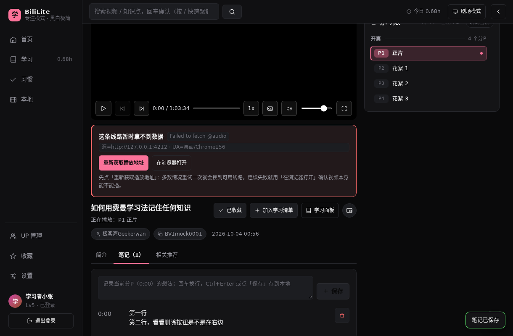
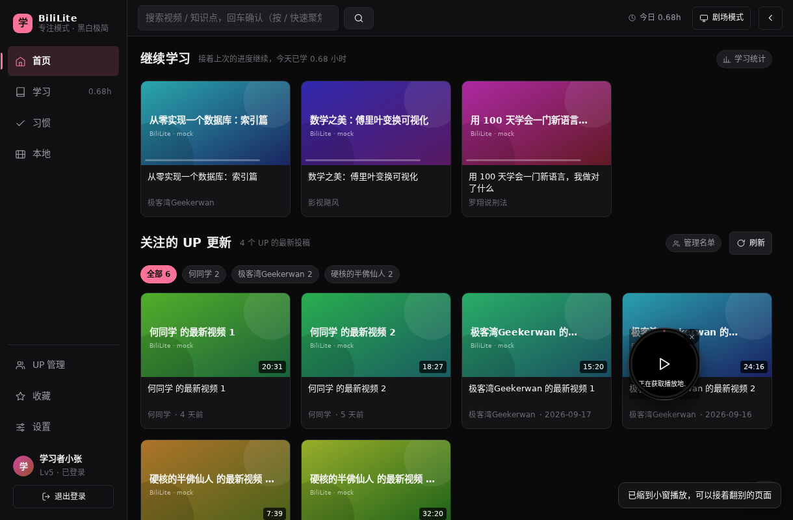

# 14 本机构建 0.4.7 —— 笔记行按钮调整 + 小窗播放改成「小圆圈」

> 这是**本仓库自己的界面定制**，上游（官方 BiliLite）0.4.4 里没有。0.4.5 的「笔记按分P独立 + 回车换行」与 0.4.6 的「备份导入恢复」都包含在这个包里。

## 1. 用户要求

用户在平板上截了播放页「笔记」tab 的图，红圈圈住每条笔记右侧的 **▶（跳转）** 按钮（m01252），并提了两件事（m01253）：

> 「1去掉花圈的部分，删除放在右边     2打开其他项目时播放的视频，放在一个小圆圈里点击继续播放   先说你的理解，确保是我想要的」

确认理解时给了三个选择题，用户的选择是：

| 问题 | 用户选择 |
|---|---|
| 笔记去掉 ▶ 后还要不要「跳到时间点」？ | **完全不要跳转** |
| 「小圆圈」要哪种形态？ | **只要把「小窗播放」按钮做成圆形入口** |
| 点圆圈之后？ | **直接回到播放页，从当前进度继续看** |

所以这次只动两处外观/交互，不改播放内核：

1. 笔记行去掉 ▶ 跳转按钮，删除按钮挪到这一行最右；
2. 小窗播放入口改成圆形图标按钮，播放中的视频从**长方形小窗**改成右下角 **112×112 的圆形气泡**，点气泡＝回播放页接着看（位置、进度都保留）。

## 2. 改动一：笔记行（`app/src/views/VideoView.vue`）

### 前

```html
<div v-for="n in notes" :key="n.id" class="field">
  <label class="mono" style="width: 62px">{{ formatClock(n.sec) }}</label>
  <div class="ctrl" style="white-space: pre-wrap">{{ n.text }}</div>
  <div class="row" style="flex: none">
    <button class="btn sm ghost" title="跳转" @click="jumpNote(n)"><Icon name="play" :size="13" /></button>
    <button class="btn sm danger" title="删除" @click="removeNote(n.id)"><Icon name="trash" :size="13" /></button>
  </div>
</div>
```

`.field` 原本是两列网格（`132px | 1fr`），第三个子元素会掉到第二行第一列——所以截图里两个按钮挤在时间点下面。

### 后（1593–1598 行）

```html
<div v-for="n in notes" :key="n.id" class="field note-row">
  <label class="mono" style="width: 62px">{{ formatClock(n.sec) }}</label>
  <div class="ctrl" style="white-space: pre-wrap">{{ n.text }}</div>
  <button class="btn sm danger note-del" title="删除这条笔记" @click="removeNote(n.id)">
    <Icon name="trash" :size="13" />
  </button>
</div>
```

- 删掉了「跳转」按钮，也删掉了 `jumpNote()` 函数（原来 `player.seek(note.sec)`）——用户明确要「完全不要跳转」，时间点文字也不做可点；
- `app/src/styles/global.css:354-372` 新增：

  ```css
  .field.note-row {
    grid-template-columns: 62px minmax(0, 1fr) auto;
    align-items: start;
  }
  .field.note-row .note-del {
    justify-self: end;
    align-self: start;
    margin-top: -2px;
  }
  ```

  三列 = 时间点 / 正文 / 最右按钮；正文仍 `white-space: pre-wrap` 保留换行。


## 3. 改动二：小窗 → 圆形气泡

### 3.1 入口：视频页的「小窗播放」变成圆形图标按钮

`app/src/views/VideoView.vue:1521-1540`：原来的文字按钮（`pip` 图标 +「小窗播放」/「正在小窗播放」）改成只放图标的圆形按钮 `button.mini-entry`，标题里仍写清用途（「点一下把视频缩成右下角的小圆圈」）。

`app/src/styles/global.css:368-378`：

```css
.btn.sm.mini-entry {
  flex: none;
  width: 34px;
  height: 34px;
  min-height: 34px; /* .btn.sm 的 min-height: var(--tap) 会把它撑成 36，这里压回去 */
  padding: 0;
  border-radius: 50%;
  justify-content: center;
}
```



### 3.2 气泡：`app/src/components/MiniPlayer.vue` 整体重画

原来是「头部标题栏 + 视频 + 底栏（播放/暂停、进度条、静音）」的长方形小窗（可换三档尺寸、可收起成一条）。现在是一个 112×112 的圆：

| 元素 | 说明 |
|---|---|
| 画面 | `<video class="mp-video">` 绝对定位铺满、`object-fit: cover`、`border-radius: 50%` —— 真正在播的画面裁成圆 |
| 进度环 | SVG 圆环（半径 47，周长 `RING_LEN = 2π×47`），`stroke-dashoffset` 跟 `mini.pct` 走，沿圆边走一圈 |
| 时间 | 圆底部一个小药丸 `0:12 / 19:33` |
| 关闭 | 右上角小 ×（`overflow: visible`，否则圆的角落会把按钮命中区裁掉） |
| 点一下 | 整个圆是 `button.mp-tap`：**回到播放页并从当前进度继续**（`backToVideo()` → `mini.videoTarget` 带 `t` 参数 → `loadPlayurl()`） |
| 拖动 | 按住圆任意位置拖（位移 > 8px 才算拖动，松手 350ms 内不当成点击），位置存 localStorage `study-bili-mini` |
| 跨页面 | 和其它页面的挂载方式不变：`App` 全局挂 `MiniPlayer`，翻到学习/首页/设置都还在 |

行为上的取舍（都是「圆形入口」这一步带来的）：

- **不再有暂停/静音/进度拖动**：圆太小放不下；回到播放页即可控制。双击/单击都按「回播放页」处理。
- **不再换尺寸/收起**：尺寸固定 112px（`BUBBLE`），右下角默认位置 `right: 18px; bottom: 96px`，首次出现时夹在可视区内。
- 加载失败/还没起播时，圆中间显示播放/刷新图标，底部药丸显示「正在获取播放地址…」「出错了，点一下回视频页」。



## 4. 验证

新增 `tools/browser/check-mini.mjs`（playwright + mock 桥 + `vite preview`，不联网）：**17/17 通过**

```
PASS  笔记行存在
PASS  笔记行只有一个按钮（只剩删除）
PASS  那个按钮是删除
PASS  删除按钮在整行最右            ← 删按钮 x=796 > 正文右边界 784
PASS  笔记正文多行保留
PASS  视频页有圆形小窗入口
PASS  入口是正圆（34×34，border-radius 50%）
PASS  小窗是正圆气泡（112×112，border-radius 50%）
PASS  气泡里有 video 元素
PASS  气泡在右下方
PASS  拖动后位置变了                 ← left 1086→966，top 584→504
PASS  拖动不会跳回视频页
PASS  点气泡后气泡消失
PASS  点气泡后回到视频页             ← #/video/BV1mock0001
PASS  点 × 能关掉小圆圈
PASS  去别的页面后小圆圈还在
PASS  无真实 console error / pageerror
```

回归：`check-notes.mjs` 9/9、`check-backup.mjs` 10/10 全过；`npm run typecheck` 0 错误；`npm run build` 通过。

> 无头 Chromium 放不了 mock 视频（`mock://` 被 CSP 拦截，和之前一样），所以脚本截图里的圆是「加载失败」态——圆形、位置、拖动、点击回播放页都能验，**真正播放画面裁成圆形只能在真机上看**。

## 5. 产物

| 项目 | 值 |
|---|---|
| 文件 | `BiliLite-0.4.7-debug.apk`（仓库根） |
| 大小 | 4,108,456 B |
| SHA-256 | `bee3d8169cc0d0db914c12b51799dfbb76a4138ac588a78501e43017e5d9f8bc` |
| package | `com.bililite.app` |
| versionCode / versionName | `11` / `0.4.7` |
| minSdk / targetSdk / compileSdk | 22 / 34 / 34 |
| 签名 | debug，CN=Android Debug，v1 + v2 通过（v3 false）；`zipalign -c -p 4` 通过 |
| 构建 | 增量 `assembleDebug` **1m 03s**（264 tasks / 29 executed）；`clean assembleDebug` 冷构建 **1m 02s**（275 tasks / 230 executed） |
| 可复现 | `clean` 后重建 sha256 与仓库内 APK **完全相同**（`bee3d816…`） |
| 校验 | APK 内 `assets/public` 与 `app/dist` 逐字节一致（只多 `cordova.js` / `cordova_plugins.js`）；包内 JS 已无 `jumpNote`，有 `note-del` / `mini-entry` / `mp-ring` / 「点一下回到视频页继续看」；版本串只有 0.4.7 |
| 下载 | `http://127.0.0.1:3080/dl/BiliLite-0.4.7-debug.apk`（本机 DSH 下载路由，见 [09](09-生成可安装APK.md)） |

## 6. 升级

- 与 0.4.6/0.4.5/0.4.4 同为 debug 签名，`adb install -r` 可直接覆盖（versionCode 11 > 10 > 9 > 8 > 7）；官方版需先卸载（签名不同）。
- 数据无变化：本轮没动 Dexie schema，也没动笔记/进度/备份格式。

## 7. 未验证 / 已知限制

- **真机上的圆形画面**没看过：无头浏览器解码不了 mock 流，本地也没有平板的 adb 连接；圆形裁切在「竖屏视频」「超宽视频」上的观感需要真机确认。
- 圆形气泡里没有暂停/静音/拖动进度，只能回播放页操作——这是「只要圆形入口」的取舍；如果之后想要「点气泡原地暂停/继续」，需要再加一套点击区分。
- 视频卡上的 `VideoCard.vue:75`「小窗播放」按钮**没有改**（仍是带文字的按钮），只有播放页的入口改成了圆形。
- 430px 窄屏下这页仍是桌面式布局（左侧固定导航），和 0.4.5 的既有问题一样，本轮不改。
