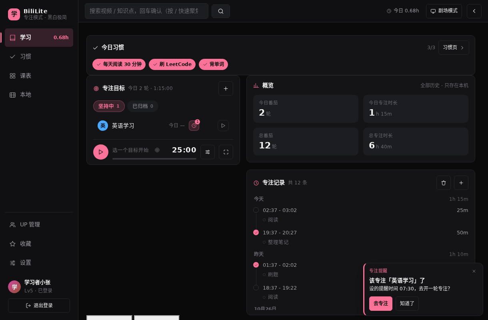
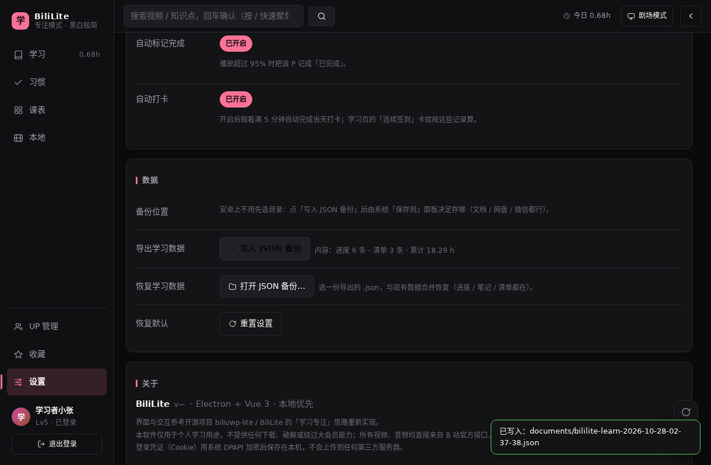
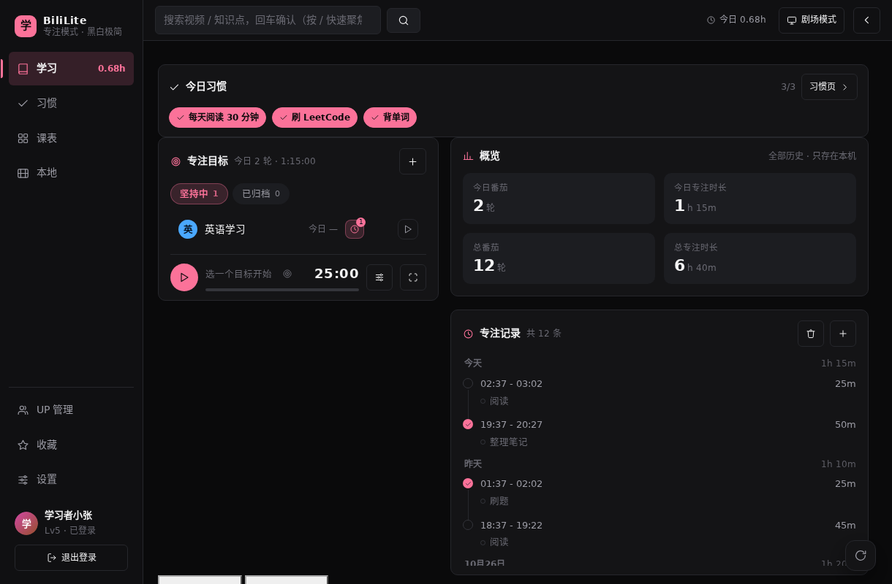

# 20 系统通知提醒、备份修复、学习页瘦身（本机构建 0.4.13）

> 这一版是本机定制（上游没有）。三项需求来自同一轮反馈（截图见下），都只在前端 / 安卓壳里改，不涉及账号与网络。
>
> | 项目 | 值 |
> |---|---|
> | 版本 | **0.4.13**（versionCode 17） |
> | 产物 | `BiliLite-0.4.13-debug.apk` |
> | 大小 | 4,169,861 B |
> | SHA-256 | `c590aa884e349f6c46cba46a5718693bfd28b8a5bdfc24ad7eb2c69b277fd24e` |
> | 下载 | `http://127.0.0.1:3080/dl/BiliLite-0.4.13-debug.apk`（固定名 `/dl/BiliLite-latest.apk`） |

## 1. 用户反馈

> 1 专注提醒最右下角，可以在软件外看到提醒，提醒有提示音
> 2 数据备份有问题
> 3 删除画圈部分

三张平板截图分别对应：

1. 学习页右下角已经弹出「专注提醒 · 该专注「英语学习」了」的卡片（0.4.12 的效果）——用户希望提醒**贴到屏幕最右下角**、**退到后台/关掉 App 也能看到**、并且**有提示音**；
2. 设置 → 数据页右上角堆了十几条红色 toast「请先选择备份目录」，点「写入 JSON 备份」根本导不出来；
3. 学习页红圈圈住：标题行「学习 · 所有数据只保存在本机（IndexedDB），不会上传。」、三张统计卡（总学习时长 / 连续签到 / 本周专注）、右上角「导出 JSON」「清空」两个按钮 —— 要求删掉。

## 2. 改动 1：提醒能出 App、有声音、贴最右下角

### 2.1 为什么之前出不了 App

0.4.12 的提醒只是页面里的一个 Vue 组件：App 一退到后台（尤其被系统冻结）就什么都不会发生；通知渠道里也从来没有发过系统通知——`app/src/stores/habits.ts` 里虽然调了 `Notification`，但安卓 WebView 里拿不到权限，静默失败。

### 2.2 做法：Capacitor Local Notifications + 本地声音

> **0.4.14 后续**：这个自定义 WAV 提示音在用户的平板上**没有响**（通知能弹、没声音）。0.4.14 已改成**系统默认通知音**（新通道 `bililite-reminders-v2` + 原生插件 `ReminderChannelPlugin`），并删掉了这个 WAV；设置页也加了「测试通知 / 通知设置」两个按钮。详见 [21-课表精简与通知声音.md](21-课表精简与通知声音.md)。

- 新增依赖 `@capacitor/local-notifications@^6.1.3`（官方插件，底层用 `AlarmManager` + `NotificationManager`，自带开机恢复）。`cap sync` 后 `android/capacitor.settings.gradle`、`app/capacitor.build.gradle` 自动带上该模块；APK 里 `classes2.dex` 有 20 处、`classes3.dex` 有 3 处 `localnotification` 类命中。
- 权限：插件自带 `RECEIVE_BOOT_COMPLETED` / `WAKE_LOCK` / `POST_NOTIFICATIONS`；本工程在 `app/android/app/src/main/AndroidManifest.xml` 又加了精确闹钟权限：

  ```xml
  <uses-permission android:name="android.permission.SCHEDULE_EXACT_ALARM" />
  <uses-permission android:name="android.permission.USE_EXACT_ALARM" />
  ```

- 提示音：新增 `app/android/app/src/main/res/raw/bililite_reminder.wav`（28,708 B，22050 Hz 单声道 16 bit，三声 880/1175/880 Hz 短哔，脚本生成）。通道 `bililite-reminders`（importance 4 + 声音 + 振动 + 呼吸灯）里 `sound` 必须给**文件名**，插件会解析成 `android.resource://com.bililite.app/raw/bililite_reminder.wav`；留空会变静音通道。
- 新建 `app/src/bridge/notify.ts`：
  - `nativeNotifySupported()`：只有 `Capacitor.isNativePlatform()` 才 true（浏览器里整体 no-op）；
  - `ensureNativeNotify()`：申请通知权限 → `createChannel`；
  - `syncNativeReminders(items)`：先取消 47000–47039 号旧通知，再按清单重排（每天重复用 `repeats: true, allowWhileIdle: true`；课表用未来 8 天的一次性 `on: {year,month,day,hour,minute}`），每条带 `extra.path`；
  - `clearNativeReminders()` / `nativePendingCount()`。
- `app/src/stores/remind.ts` 新增 `nativeItems()` 与 `syncNative()`：
  - 专注目标：每个 `reminders` 时间一条，每天重复，点通知去 `/learn`；
  - 习惯：`remindOn` 打开的习惯，按 `remindAt` 每天重复，点通知去 `/habit?h=<id>`；
  - 课表：按「未来 8 天里星期对得上的日子」逐天排一次性通知（按 `remindLead` 提前），点通知去关联视频或学习页。
- `app/src/App.vue`：启动后 `remind.syncNative()`；设置/习惯/课表数据变化后 debounce 1.2s 重排；原生平台监听 `localNotificationActionPerformed` 按 `extra.path` 跳转。
- App 内的提醒卡片（`app/src/components/ReminderCards.vue`）位置改成贴屏幕右下角：`right: calc(12px + env(safe-area-inset-right))`、`bottom: calc(10px + env(safe-area-inset-bottom))`；有卡片时给 `<body>` 加 `has-reminder`，`global.css` 里让右下角刷新浮钮暂时隐藏，免得压住卡片。

## 3. 改动 2：备份导出 bug

根因：`app/src/views/SettingsView.vue` 的 `exportBackup()` 第一行是

```ts
if (!conf.value.backupPath) { ui.err('请先选择备份目录'); return }
```

但 0.4.6 起安卓上已经把「备份目录 / 选择 / 打开」整行藏掉了（安卓 WebView 没有真实目录），`backupPath` 永远是空字符串 → 在安卓上点「写入 JSON 备份」100% 弹「请先选择备份目录」，正是截图里那一列红 toast。

而真正写文件的 `app/src/bridge/android.ts` 里 `backup:write` **不需要目录**：它写 `Directory.Documents`（失败退 `Cache`），再 `shareFile()` 弹系统「保存到」面板，把 `lastExportUri` 留给「打开」用。

修复：安卓上跳过目录检查，并把默认目录名传下去：

```ts
if (!isAndroid.value && !conf.value.backupPath) { ui.err('请先选择备份目录'); return }
await bili.backup.write(conf.value.backupPath || 'documents', text)
```

现在安卓上点「写入 JSON 备份」直接出系统「保存到」面板。

## 4. 改动 3：学习页瘦身

`app/src/views/LearnView.vue` 删掉：

- 顶部标题行（`.page-head`：标题「学习」+ 说明文案）；
- 三张统计卡（`.stat-grid`：总学习时长 / 连续签到 / 本周专注）；
- 右上角「导出 JSON」「清空」两个按钮（连 `exportJson()` / `clearAllData()` / `stats` computed 一起删；导出/备份统一走设置页）。

留下的：今日习惯、专注目标面板、专注概览与记录、学习进度 / 学习清单。

## 5. 验收

新增 `tools/browser/check-reminder13.mjs`（端口 4220，`CHECK_REMINDER_OUT` 可改输出目录），**13/13 通过**：

```
PASS  学习页没有标题行
PASS  学习页没有三张统计卡
PASS  学习页不再出现「导出 JSON」
PASS  学习页不再出现「清空」按钮
PASS  学习页「今日习惯 / 专注目标」还在
PASS  到了设定的时间会弹提醒卡片 — {"focus":["focus:英语学习:2026-10-28:07:30"],"course":[]}
PASS  提醒卡片贴在屏幕最右下角 — {"right":12,"bottom":10,"w":300}
PASS  有卡片时右下角刷新浮钮让位 — {"right":12,"bottom":10,"floatDisplay":"none","bodyClass":"has-reminder"}
PASS  关掉卡片后浮钮恢复 — {"count":0,"display":"flex"}
PASS  浏览器里系统通知为 no-op（supported=false）
PASS  安卓下不显示「备份目录」行
PASS  安卓下点「写入 JSON 备份」能导出 — 已写入：documents/bililite-learn-2026-10-28-02-31-06.json
PASS  无真实 console error / pageerror
```

旧脚本全部回归通过：`check-mini` 17/17、`check-notes` 9/9、`check-backup` 10/10、`check-automini` 18/18、`check-nohome` 10/10、`check-focusdefaults` 11/11、`check-resume` 9/9、`check-schedule` 27/27、`check-habitnote` 19/19。

浏览器里只能验「提醒卡片的位置/让位」和「备份不再被目录拦住」；**系统通知本身只能在安卓壳里验证**（浏览器里 `nativeNotifySupported()` 恒 false）。

## 6. 产物与构建

| 项目 | 值 |
|---|---|
| 文件 | `BiliLite-0.4.13-debug.apk` |
| 大小 | 4,169,861 B（比 0.4.12 大 ~52 KB：多了通知插件 + 提示音） |
| SHA-256 | `c590aa884e349f6c46cba46a5718693bfd28b8a5bdfc24ad7eb2c69b277fd24e` |
| versionCode / versionName | `17` / `0.4.13` |
| minSdk / targetSdk / compileSdk | 22 / 34 / 34 |
| 签名 | debug，v1 + v2 通过（v3 false） |
| 构建 | 增量 `assembleDebug` 12s（290 tasks / 23 executed）；`clean assembleDebug` **46s**（302 tasks / 252 executed，复跑一次 42s） |
| 可复现 | `clean` 后重建 sha256 相同 |
| 包内 | `res/raw/bililite_reminder.wav`（28,708 B）；权限含 `SCHEDULE_EXACT_ALARM`、`USE_EXACT_ALARM`、`RECEIVE_BOOT_COMPLETED`、`WAKE_LOCK`、`POST_NOTIFICATIONS`；dex 里有 local-notifications 插件类；`index-*.js` 含 `bililite_reminder.wav` |

## 7. 升级 / 安装

- 与 0.4.3–0.4.12 一样是 debug 签名，**可直接覆盖升级**（versionCode 17 > 16 > …）；装过官方版需先卸载（签名不同）。
- 第一次打开会弹「允许通知」：**建议允许**，否则只剩 App 内卡片，退到后台就没有提醒了（Android 13+ 需要这个权限才会弹通知）。
- 部分国产 ROM 对「精确闹钟 / 后台自启」有限制：如果提醒不准时，去系统设置里给 BiliLite 打开「自启动 / 后台运行 / 精确闹钟」权限。

## 8. 限制 / 未验证

- 真机未实测：本机没有连接安卓设备，系统通知（声音、锁屏显示、点通知跳转、开机后是否恢复）只有在平板上装 0.4.13 才能确认；
- 提醒只在 App 至少被打开过一次之后才会排进系统；卸载重装后需要重新打开一次；
- 通知按「每天重复」排，若改时区/手动改系统时间可能出现偏差；
- 课表提醒只排未来 8 天的，超过 8 天不重新打开 App 就不会提醒；
- 备份导出仍走系统「保存到」面板：安卓 10 及以下可能没有 Documents 权限，会退到 Cache 再分享（在面板里能选文件管理器）。

## 9. 截图（浏览器验收产物）

| 图 | 内容 |
|---|---|
|  | 提醒卡片贴在屏幕最右下角；右下角刷新浮钮已让位 |
|  | 安卓模拟下设置页：没有「备份目录」行，点「写入 JSON 备份」直接显示「已写入：documents/…json」 |
|  | 学习页：标题行、三张统计卡、「导出 JSON / 清空」按钮都已删除 |

注：截图是在无头 Chromium + mock 桥里跑的，所以页面是深色桌面布局、视频区是 mock 数据；系统通知本身在这里看不到（原生能力在浏览器里是 no-op），需要在平板/模拟器上验。
