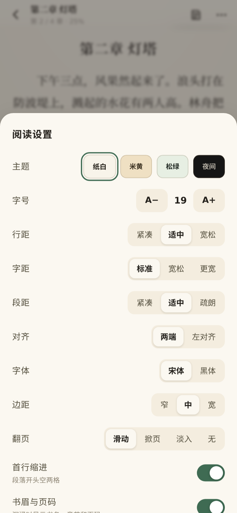
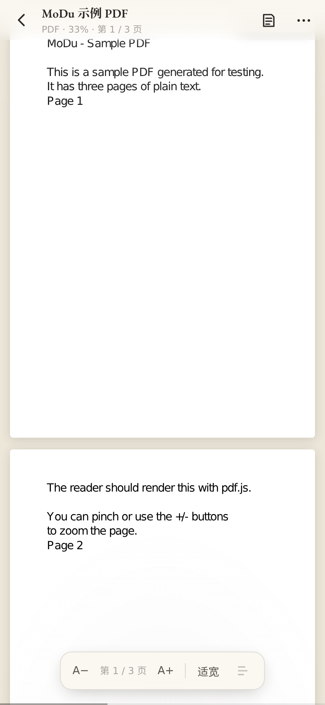
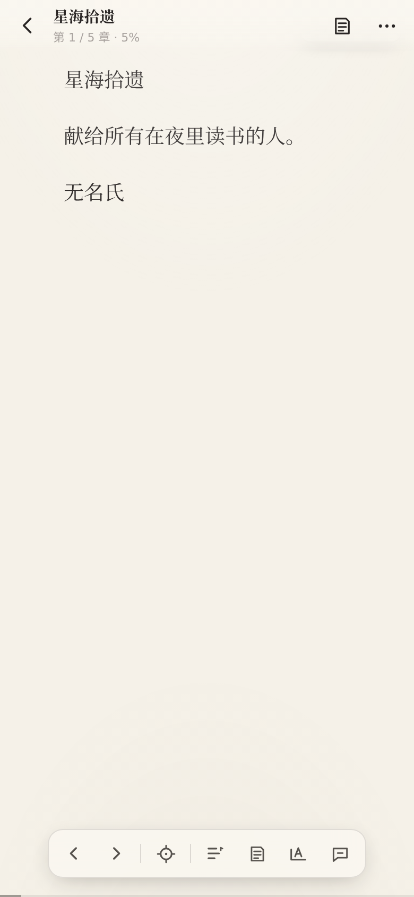

# 墨读 · Android 电子阅读器

一个完全离线的安卓阅读器，照着 [ReadAware](https://readaware.app) 的阅读体验做的轻量实现：
**逐句聚焦 + 划线批注 + 阅读统计 + 阅读助手**，支持 TXT / EPUB / PDF / FB2 / CBZ 五种格式。
数据全部存在本机（IndexedDB），不登录、不上传、不联网也能读；只有你主动配置 AI Key 时才会请求你指定的接口。

体积对比：原版 ReadAware 的 Android 包约 55 MB（Tauri + 52 MB Rust 动态库），墨读的 APK 约 6 MB。


| 沉浸阅读（右上角页数 / 本次计时） | 逐句聚焦 | 选中划线 |
| --- | --- | --- |
|  |  |  |

| 划线批注 | 阅读统计 | 目录 |
| --- | --- | --- |
|  |  |  |

| 阅读外观 | 夜间 | PDF |
| --- | --- | --- |
|  |  |  |

| 漫画（CBZ） | FB2 |
| --- | --- |
|  |  |

## 下载安装

- 直接下载 APK（推荐）：<https://github.com/1suien/BiliLite/raw/modu/MoDu-0.3.0-debug.apk>
  `MoDu-0.3.0-debug.apk`，6,123,722 B，debug 签名（v1+v2 校验通过），sha256 `160d5159f0cfd02b48b13c0bafa2fd9ef4fc33890a14111f419b2b26bdf4312b`
- 源码：<https://github.com/1suien/BiliLite/tree/modu>（分支 `modu`，源码在 `modu/` 目录；tag `modu-v0.3.0`）

安装：下载 APK → 点开 → 首次允许「安装未知应用」→ 安装。包名 `com.readawre.app`，minSdk 22（Android 5.1+），targetSdk 34。

## 0.3.0 新增：阅读手感

这一版只补「读起来的手感」，照着真书和 ReadAware 的阅读页逐项对齐：

- **跟手翻页**：按住书页左右拖动时，正文跟着手指走（到首尾页有阻尼），松手按距离和速度决定翻页还是弹回；点按 / 键盘 / 滚轮翻页仍然可用。
- **四种翻页动画**：滑动（默认）/ 掀页（带一点页厚的明暗变化）/ 淡入 / 无动画，随机器性能选。
- **书眉与页码**：工具条收起后，顶部一行极淡的书名 · 章节，底部居中「当前页 / 总页」，像真书的天头地脚；不想要可以在外观里关掉。
- **底部进度线可拖**：页脚一条 2px 细线，工具条出现时按住拖动即可跳到全书任意位置，松手立即重排定位。
- **排版更细**：字距（标准 / 宽松 / 更宽）、段距（紧凑 / 适中 / 疏朗）、两端对齐 / 左对齐、首行缩进开关；正文行首标点悬挂与 `line-break: strict`，中文标点不会顶到栏边。
- **拉丁字体**：内置 EB Garamond（常规 + 斜体，两个 woff2 共约 70 KB，只覆盖拉丁字符），英文书名、页码、数字不再用系统无衬线字。
- **纸面更安静**：去掉了上一版尝试的噪点纹理，只留极淡的顶光与底部暖影，长时间阅读不晃眼。
- 端到端验收扩到 **36 项**（新增书眉 / 页码 / 跟手拖拽 / 进度拖动断言）。

## 0.2.0 新增

- **逐句聚焦**：按句切分（`Intl.Segmenter`，中文/英文都行），当前句浅灰底、其余句变淡；左右点按 / 方向键 / 滚轮一句一句走，跨页自动翻到下一句所在页，点某句直接定位。可以从工具条或阅读外观里开关。
- **划线批注**：选中文字弹出浮动菜单，四色划线（黄 / 绿 / 蓝 / 粉）、写想法、复制、问 AI；点已划的线可以改色、补笔记、删除。批注按「章 + 字符偏移」锚定，改字号 / 转屏 / 重排后仍然贴住原文；「书中笔记」按目录章节分组，点一条跳到原文并闪一下。
- **阅读统计**：按会话记录阅读时长与翻页数，切后台自动暂停；统计页有总时长、连续天数、今日 / 本周 / 已读天数 / 平均每天、最近 7 天柱状图、按书籍排行、里程碑。
- **阅读助理（可选）**：自带 Key 的 OpenAI 兼容接口（OpenAI / DeepSeek / 通义千问预设，也可填任意 baseUrl + 模型名），流式输出，可停止；发送时自动带上书名、当前章、选中原文和上下文。Key 只存本机 IndexedDB，不写日志、不上传。
- **新格式**：FB2（XML 解析、编码回退、章节偏移、封面）、CBZ（自然序图片页、预取、点击放大 1.7×）。
- **书架重做**：居中品牌头、搜索（书名 / 作者）、在读 / 未读 / 读完筛选、最近打开 / 添加 / 书名 / 进度排序、继续阅读卡片、统计入口。
- **阅读页重做**：暖纸底、居中章节标题、沉浸式自动隐藏顶栏、右上角常驻「页 / 总页 │ 本次计时」胶囊、底部居中浮动工具条（上一页 / 下一页 / 逐句聚焦 / 目录 / 笔记 / 外观 / 助手）。
- **统计 / 笔记 / 设置**三个新面板，Esc 逐层关闭，侧滑翻页、键盘和滚轮翻页都保留。

## 功能

- **书架**：多选导入（带进度）、搜索、筛选、排序、封面 / 格式角标 / 阅读百分比、继续阅读、长按「从头开始读 / 删除」；内置 3 本示例书（TXT / EPUB / PDF）。
- **TXT**：自动识别 UTF-8 / UTF-16 / GB18030（含 BOM），按「第 N 章 / Chapter N / 序章 / 楔子…」自动分章，识别不到标题时按长度切节。
- **EPUB**：`container.xml → OPF`，读取 spine / 目录（nav.xhtml 或 ncx），正文清掉脚本、表单、内联事件，图片解包成 blob 显示；封面自动提取。
- **PDF**：pdf.js 连续滚动，页面懒渲染（离开视野释放 canvas），0.6×–2.4× 缩放，A− / A+ / 适宽，页码与进度。
- **FB2 / CBZ**：见上。
- **排版**：CSS 多列分页（整页翻页、无滚动条），纸白 / 米黄 / 松绿 / 夜间四套主题，字号 14–30，行距三档，字距 / 段距各三档，两端对齐 / 左对齐，首行缩进开关，宋体 / 黑体，页边距三档，滑动 / 掀页 / 淡入 / 无动画四种翻页，书眉与页码可关。
- **进度**：按「章 + 页 + 百分比」记录，翻页、退后台、退出都会落盘；改字号、转屏保持相对位置。
- **交互**：跟手拖拽翻页、左右点按翻页、中间点按呼出 / 收起工具条、横滑翻页、键盘 ←/→/空格/PageUp/PageDown/Esc、滚轮翻页；阅读时常亮（Wake Lock）可关；系统返回键从阅读器回书架。

## 格式支持

| 格式 | 阅读方式 | 说明 |
| --- | --- | --- |
| TXT | 分页排版 | 自动分章、编码识别 |
| EPUB | 分页排版 | 目录 / 图片 / 封面 |
| FB2 | 分页排版 | 章节偏移、封面、windows-1251 回退 |
| PDF | 连续滚动 | 缩放、目录（有 outline 时） |
| CBZ | 图片翻页 | 自然序、预取、点击放大 |

暂不支持 MOBI / AZW3 / KF8 / CBR / HTML（ReadAware 支持，但它们分别需要 Kindle 容器解析和额外清洗，没有做半成品）。批注和进度目前只在本机，没有做跨设备同步。

## 技术栈

Capacitor 6（Android WebView 壳） + Vue 3 + TypeScript + Vite 5 + vue-router（hash） + Dexie（IndexedDB） + JSZip + pdf.js 3.11。

AI 客户端是自己写的最小 OpenAI 兼容 SSE 客户端（`src/lib/ai.ts`），没有引入 SDK。

## 目录结构

```
app/
  src/
    views/        ShelfView（书架）、ReaderView（阅读器装配 + 工具条 + 面板 + 会话统计）
                  StatsView（阅读统计）
    readers/      ReflowReader（TXT/EPUB/FB2 分页 + 逐句 + 批注渲染）
                  PdfReader（PDF）、ComicReader（CBZ）
    components/   SettingsSheet（阅读外观）、TocSheet（目录）、NotesSheet（书中笔记）、AiSheet（阅读助手）
    lib/          encoding（编码/分章）、epub、pdf、fb2、cbz、ai（SSE）、stats（统计聚合）、
                  import（导入入库）、cover（生成封面）、sample（示例书）、util
    db/           Dexie 表结构（books / files / covers / settings / annotations / sessions）
    dev/          ?seed=1 时灌入示例书
  android/        Capacitor Android 工程
tools/
  browser/check.cjs   无头浏览器端到端验收（书架→TXT→聚焦→划线→笔记→统计→FB2/CBZ→PDF，36 项断言）
  browser/probe.cjs   单点探针（IndexedDB / 排版尺寸调试）
  gen-assets.cjs      生成各密度图标与启动图
docs/screenshots/     验收截图
```

## 本地开发

```bash
cd app
npm install          # 会自动把 pdf.js 的 cmaps/standard_fonts 拷进 public/pdfjs
npm run dev          # http://localhost:5173，加 ?seed=1 灌示例书
npm run typecheck    # vue-tsc
npm run build        # 产物 dist/

# 浏览器端验收（需要 dev server 在 5173）
cd .. && NODE_PATH=/root/学习软件/tools/browser/node_modules node tools/browser/check.cjs
```

## 打 APK

Android 壳是 Capacitor 生成的标准工程（包名 `com.readawre.app`，minSdk 22 / targetSdk 34）。

```bash
cd app
npm run build && npx vue-tsc --noEmit
NODE_OPTIONS="--require /tmp/patch-userinfo.cjs" npx cap sync android   # 见下方说明
cd android
printf 'sdk.dir=/opt/android-sdk\n' > local.properties
JAVA_HOME=/opt/toolchain/jdk17 PATH=/opt/toolchain/jdk17/bin:$PATH \
GRADLE_USER_HOME=/tmp/gradle-home ./gradlew --no-daemon --max-workers=2 --offline \
  -Pandroid.aapt2FromMavenOverride=/opt/toolchain/aapt2-bin/aapt2 \
  -Dorg.gradle.jvmargs="-Xmx900m -XX:MaxMetaspaceSize=320m -Dfile.encoding=UTF-8" \
  clean assembleDebug
# 产物：app/android/app/build/outputs/apk/debug/app-debug.apk
```

说明：

- `/tmp/patch-userinfo.cjs` 是这个 aarch64 环境里给 Node 打 `os.userInfo()` 补丁用的，正常电脑不需要。
- `-Pandroid.aapt2FromMavenOverride` 指向本机可执行的 aapt2（离线构建，不联网拉 maven 包）。
- 签名是 Android debug 签名，用于自用安装；上架应用商店需要换正式签名。
